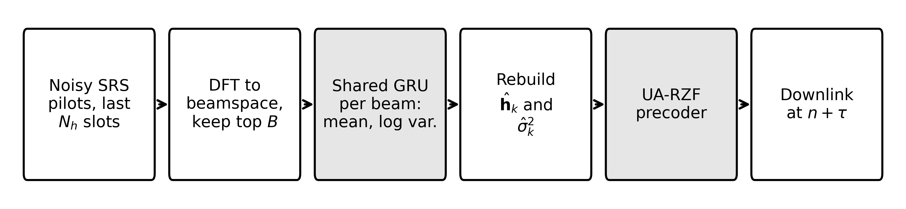

# BRACE: Uncertainty Aware Beamspace Channel Prediction and Precoding for High Mobility Massive MIMO

Code for the paper

> G. Arul Dalton, P. Sankar and A. Bamila Virgin Louis, "Uncertainty Aware Beamspace Channel Prediction and Precoding for High Mobility Massive MIMO," submitted to *Wireless Personal Communications* (Springer).

BRACE (beamspace recurrent aging compensation with error awareness) predicts aged massive MIMO channels in the beamspace with one small shared gated recurrent unit (GRU, 3,459 parameters) that also outputs the variance of its own error. An uncertainty aware regularized zero forcing (UA-RZF) precoder adds that variance to its regularization in closed form. BRACE-A adapts the number of predicted beams to the channel's energy spread.



## Repository layout

| Path | Contents |
|---|---|
| `brace/config.py` | System and training parameters (Tables 1 and 2 of the paper) |
| `brace/channels.py` | Geometric multipath channel and 3GPP TR 38.901 style UMa LOS/NLOS channel |
| `brace/gru.py` | GRU in `autograd`, heteroscedastic NLL training (Eq. 4) |
| `brace/beamspace.py` | Fixed and energy adaptive beam selection, channel and error reconstruction (Eq. 5) |
| `brace/baselines.py` | AR-16 and AR-64 predictors |
| `brace/precoding.py` | RZF, UA-RZF (Eq. 6) and sum rate (Eq. 3) |
| `brace/data.py`, `brace/metrics.py` | Training data, NMSE and paired statistics |
| `scripts/train.py` | Train BRACE or the antenna domain GRU baseline |
| `scripts/evaluate_geometric.py` | Speed and horizon sweeps (Figs. 2 to 5, Tables 3 and 4) |
| `scripts/evaluate_uma.py` | UMa validation, beam budget and BRACE-A (Fig. 6, Table 5) |
| `scripts/analyze.py` | Computes every reported number into `results/results.json` |
| `scripts/make_figures.py` | Draws Figs. 1 to 6 (600 dpi PNG and TIFF) |
| `scripts/run_all.sh` | Reproduces the whole paper |
| `results/paper_results.json` | The values reported in the paper, for comparison |
| `tests/test_smoke.py` | 30 second end to end check |

## Installation

```bash
git clone https://github.com/GArulDalton/brace-channel-prediction.git
cd brace-channel-prediction
pip install -r requirements.txt
python tests/test_smoke.py
```

Python 3.9 or newer. No GPU is needed; the networks are tiny and run on one CPU core.

## Reproducing the paper

```bash
bash scripts/run_all.sh          # about 1 hour on one CPU core
```

This trains 10 models (geometric channel: BRACE and antenna GRU for horizons of 1, 2, 4 and 8 slots; UMa: both at 4 slots), runs every evaluation, writes `results/results.json` and redraws the figures into `figures/`. All random seeds are fixed, so the numbers match `results/paper_results.json`. For example, at 120 km/h and a 1 ms horizon:

| Method | NMSE (dB) | Sum rate at 20 dB (bit/s/Hz) |
|---|---|---|
| Sample-and-hold | 3.08 | 13.93 |
| AR-64 | -4.05 | 19.19 |
| Antenna domain GRU | -2.67 | 15.33 |
| BRACE + RZF | -4.58 | 22.93 |
| BRACE + UA-RZF | -4.58 | 23.23 |

Single steps:

```bash
python scripts/train.py --channel geometric --domain beam --tau 4
python scripts/train.py --channel geometric --domain ant  --tau 4
python scripts/evaluate_geometric.py --job speed --speeds 120
python scripts/analyze.py
python scripts/make_figures.py                 # figures from the paper values
python scripts/make_figures.py --source run    # figures from your own run
```

## Main parameters

3.5 GHz carrier, 60 kHz subcarrier spacing (0.25 ms slots, SRS every slot), 32 antenna half wavelength ULA, 4 single antenna users, pilot SNR 15 dB, 16 slot history, horizons 0.25 to 2 ms, speeds 30 to 350 km/h, GRU with 32 hidden units trained with Adam (learning rate 4e-3, batch 512, 3,500 steps) on 60,000 series using noisy future pilots as labels.

## Notes

The UMa generator follows the stochastic procedure of 3GPP TR 38.901 Section 7.5 in narrowband form; check the parameter values in `brace/channels.py` against the specification before reusing it for other studies. A large language model (Claude, Anthropic) assisted in writing this code; the authors reviewed it and verified the results.

## Citation

See `CITATION.cff`. Please cite the paper if you use this code.

## License

MIT, see `LICENSE`.
